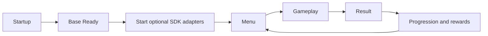

# Kiến trúc game

| Thư mục | Chủ sở hữu |
|---|---|
| Gameplay | Board model, rule, resolution, presenter/view, input, event và level provider |
| Meta | Economy, Hearts, inventory booster, reward, shop, wheel và map |
| UI | Screen/popup/HUD cụ thể; lớp nối animation/button feedback với base |
| Startup | Khởi tạo game, GameAppFlowManager và adapter SDK |
| Configs | Các type cấu hình game |
| Content | Art, prefab, animation, audio, Resources, scene và config asset |
| LevelEditor | Runtime editor, validation, generation, import/export JSON |
| Editor | Công cụ cấu hình, scene switcher và inspector asset |

Namespace game cũ được giữ ở các lớp di chuyển để hạn chế thay đổi type serialized. Vị trí thư mục mới là nguồn tra cứu; không suy namespace theo folder. Script/asset di chuyển giữ `.meta` và GUID. Các đường dẫn Resources tương đối vẫn giữ nguyên.

Dependency: Game → Base/Integrations. Luật chơi và dữ liệu booster không đưa vào base. Startup giữ lifetime UI root và nối camera scene; UIManager của Base giữ reference layout/camera và sở hữu cache/stack/transition. UIManager tạo overlay trực tiếp dưới Overlays qua API riêng, không có service trung gian.

Sơ đồ chi tiết hiện tại: [game-flow.mmd](game-flow.mmd). Chi tiết khởi tạo xem [startup](startup-integrations.md).
